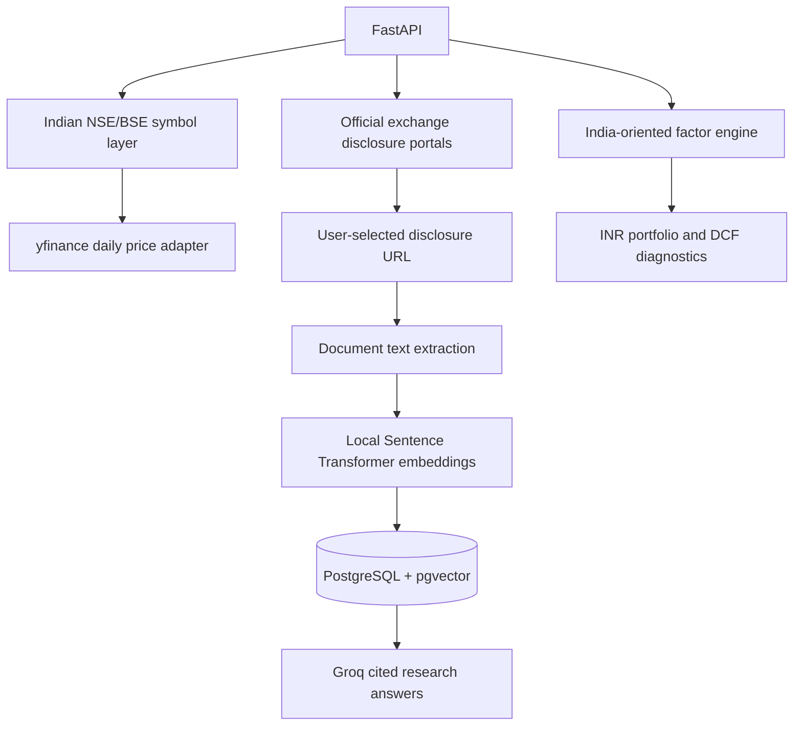

# EquityMind Research Studio — India Edition

**Evidence-aware equity research for Indian listed companies on NSE and BSE.**

EquityMind is a research workbench for Indian cash equities. Its market defaults are India (IN), INR, NSE and the Asia/Kolkata timezone. It combines daily market-price history, transparent factor screens, portfolio concentration diagnostics, DCF sensitivities, and citation-grounded research over issuer disclosures.

> **Prototype status (v0.2):** NSE/BSE symbol handling, a curated Indian watchlist, optional daily price/history retrieval, and manual ingestion of exchange-hosted documents are implemented. The watchlist is not a complete exchange security master. yfinance data is not an exchange-authorised or guaranteed real-time feed. The bundled company research fixtures are entirely synthetic: all ratios, prices, analyst estimates and price paths are invented. Do not treat them as actual financial data or investment signals.

## India-specific capabilities

| Capability | What it does |
| --- | --- |
| NSE/BSE symbol handling | Resolves NSE symbols to Yahoo Finance `.NS` symbols and BSE scrip codes to `.BO`; explicit suffixes are also accepted. |
| Curated Indian watchlist | Starts with 20 widely followed Indian large-cap names; this is a watchlist, not a full exchange master or recommendation list. |
| Daily market data | Optional yfinance adapter returns the last available daily quote and daily OHLCV history, denominated in INR when the provider reports INR. |
| Seven-factor research screen | Valuation, momentum, historical risk, quality, analyst consensus, promoter-pledge risk and news sentiment. Missing inputs remain unavailable rather than being fabricated. |
| Promoter pledge signal | Replaces the US-centric short-interest factor with promoter-shareholding pledge percentage, when a dated shareholding-pattern disclosure provides it. |
| NSE/BSE disclosures | Links to official exchange disclosure portals and accepts user-supplied, direct HTTPS NSE/BSE-hosted documents for extraction and filing-grounded RAG. |
| Exchange-aware RAG | Stores market country, exchange, ticker, filing type, period and source URL alongside each embedded chunk. |
| INR portfolio and DCF | Portfolio totals and per-share DCF outputs explicitly identify INR. Sector shocks include Indian sector names such as IT, banking, FMCG, telecom, autos and pharma. |

## Indian market data sources and limitations

- **Primary issuer disclosures:** Start with the [NSE corporate announcements](https://www.nseindia.com/companies-listing/corporate-filings-announcements), [NSE financial results](https://www.nseindia.com/companies-listing/corporate-filings-financial-results), [NSE shareholding patterns](https://www.nseindia.com/companies-listing/corporate-filings-shareholding-pattern), and corresponding BSE corporate announcements, [financial results](https://www.bseindia.com/corporates/Comp_Resultsnew.aspx) and [shareholding patterns](https://www.bseindia.com/corporates/Sharehold_Searchnew.aspx). SEBI also maintains a [curated corporate-filings directory](https://www.sebi.gov.in/curation/corporate_filings.html).
- **Market prices:** the optional `yfinance` adapter uses Yahoo Finance's publicly available interfaces. Its maintainers state that the project is unaffiliated with Yahoo, intended for research/education, and that the underlying Yahoo Finance API is intended for personal use. Review the terms governing downloaded data. This adapter is for local research and prototyping, not a commercial or exchange-authorised production feed. Use an exchange-authorised or appropriately licensed market-data provider for production and verify prices against NSE/BSE. See the [yfinance package notice](https://pypi.org/project/yfinance/).
- **Coverage:** the adapter retrieves daily bars, not guaranteed tick-by-tick or real-time quotes. Provider data can be delayed, incomplete or unavailable. Do not assume that a returned last session date is the current date.
- **Fundamentals:** the quote adapter does not provide a complete, standardised Indian-company financial-statement dataset. Valuation, profitability and analyst factors are not automatically computed from the market quote endpoint. Ingest source filings or connect a licensed fundamentals provider before using those factors for live issuer research.
- **Promoter pledge:** the signal expects the pledged percentage of promoter shareholding, not the pledged percentage of total company shares. Record the exact reporting period and denominator from the original shareholding-pattern filing.
- **Manual disclosure ingestion:** this prototype does not crawl or automatically discover every filing from NSE/BSE. The user selects a company disclosure in the exchange portal and supplies its direct HTTPS attachment URL to the ingestion endpoint. Searchable PDFs are supported; image-only/scanned PDFs are not OCR'd.
- The legacy SEC EDGAR endpoints remain available for US filings, but are not used as the Indian filing workflow.

The app's configured market timezone is Asia/Kolkata. Exchange notices can introduce special sessions or changed schedules, so this application does not hard-code trading-day or holiday decisions; check the exchange's current market-timings and holiday notices before relying on session status.

## Architecture



## Technology

- Python 3.11+
- FastAPI and Pydantic v2
- yfinance (optional daily-price adapter)
- PostgreSQL and pgvector
- Sentence Transformers local embeddings
- pypdf for searchable exchange PDFs
- Groq chat-completion API
- pytest

## Quick start

### 1. Create a Python environment

**Windows PowerShell**

```powershell
py -3.12 -m venv .venv
.\.venv\Scripts\Activate.ps1
python -m pip install --upgrade pip
```

### 2. Install India, database, embedding and development extras

```powershell
python -m pip install -e ".[india-market,database,local-embeddings,dev]"
```

### 3. Configure

```powershell
Copy-Item .env.example .env
notepad .env
```

Set `GROQ_API_KEY`, choose a strong local `POSTGRES_PASSWORD`, and update the SEC User-Agent contact email only if using the legacy US SEC endpoints. The India defaults are:

- `MARKET_COUNTRY=IN`
- `MARKET_EXCHANGE=NSE`
- `MARKET_CURRENCY=INR`
- `MARKET_TIMEZONE=Asia/Kolkata`

Keep `.env` private and never commit API credentials. Do not re-copy `.env.example` over an existing configured `.env`.

### 4. Run the API

For local Python development with PostgreSQL available:

```powershell
uvicorn equitymind.api:app --reload
```

For the Docker setup, install Docker Desktop and set its large-data storage location to a drive with sufficient space. Then run:

```powershell
docker compose up --build -d
docker compose ps
```

The Docker image installs the India market and searchable-PDF adapters, database driver and local embeddings. PostgreSQL initialises `sql/schema.sql` when the database volume is first created. The schema contains idempotent migration statements for the earlier SEC-only filing layout.

Open <http://127.0.0.1:8000/health> and <http://127.0.0.1:8000/docs>.

## API reference

| Method | Endpoint | Purpose |
| --- | --- | --- |
| GET | `/api/v1/market/universe` | Curated NSE Indian-equity watchlist |
| GET | `/api/v1/market/quote/{symbol}?exchange=NSE` | Last available daily quote in INR |
| GET | `/api/v1/market/history/{symbol}?exchange=NSE&period=1y` | Daily OHLCV history |
| GET | `/api/v1/market/disclosures` | Official NSE/BSE/SEBI disclosure links |
| POST | `/api/v1/filings/india/ingest` | Ingest a user-selected NSE/BSE-hosted disclosure |
| POST | `/api/v1/evidence/search` | Search country- and exchange-scoped filing passages (defaults to India) |
| POST | `/api/v1/research/rag` | Groq answer grounded in retrieved filing passages |
| GET | `/api/v1/universe` | Supported synthetic Indian research fixtures |
| POST | `/api/v1/research` | Seven-factor research screen over synthetic fixtures |
| POST | `/api/v1/portfolio/analyze` | INR portfolio weights and sector-stress diagnostics |
| POST | `/api/v1/scenarios/dcf` | INR bull/base/bear DCF sensitivity |
| POST | `/api/v1/citations/audit` | Audit response citation IDs against supplied evidence |
| GET | `/api/v1/filings/recent/{cik}` | Legacy US-only SEC EDGAR discovery |
| POST | `/api/v1/filings/ingest` | Legacy US-only SEC filing ingestion |

### Get an Indian daily quote

NSE symbol:

```http
GET /api/v1/market/quote/RELIANCE?exchange=NSE
```

BSE scrip code:

```http
GET /api/v1/market/quote/500325?exchange=BSE
```

Daily history (1 year by default):

```http
GET /api/v1/market/history/TCS?exchange=NSE&period=1y
```

Explicit Yahoo-style suffixes `RELIANCE.NS` and `500325.BO` are also accepted. The `source_note` and `last_session_date` in every response describe the adapter and data date.

### Ingest an Indian company disclosure

1. Find the issuer's annual report, quarterly result, corporate announcement, shareholding pattern, investor presentation or credit-rating disclosure in the official NSE/BSE portal.
2. Copy the direct HTTPS attachment URL from the exchange. The API accepts direct NSE/BSE-hosted file URLs, not a general web search URL.
3. Submit the following JSON to `POST /api/v1/filings/india/ingest`:

```json
{
  "ticker": "RELIANCE",
  "exchange": "NSE",
  "filing_type": "QUARTERLY_RESULTS",
  "filing_date": "2026-10-30",
  "document_id": "exchange-document-reference",
  "filing_url": "https://www.nseindia.com/..."
}
```

Accepted types: `ANNUAL_REPORT`, `QUARTERLY_RESULTS`, `CORPORATE_ANNOUNCEMENT`, `SHAREHOLDING_PATTERN`, `INVESTOR_PRESENTATION`, `CREDIT_RATING` and `OTHER`. The ingestion endpoint validates the NSE/BSE host, extracts text, creates local embeddings, and stores the exchange, ticker, filing date, document identifier and source URL in pgvector. Searchable PDF files are supported; scanned image PDFs require a text-enabled copy.

Then ask a question using `POST /api/v1/research/rag`:

```json
{
  "ticker": "RELIANCE",
  "market_country": "IN",
  "exchange": "NSE",
  "question": "Summarise the key risks management disclosed in this filing.",
  "top_k": 6
}
```

The answer includes retrieved source passages and a citation-ID audit. Citation auditing checks whether reference IDs resolve to retrieved passages; it does not independently validate the model's interpretation.

### INR portfolio and DCF

All portfolio market values and DCF monetary inputs are interpreted as INR. Keep revenue, cash, debt, market capitalisation, share count and per-share price units consistent. The DCF endpoint is a mechanical sensitivity engine; it does not automatically retrieve financial statements, compute cost of equity, or infer a defensible discount rate.

## Run tests

```powershell
pytest
```

## Research safeguards

- All bundled India-company fixture metrics, price histories, analyst targets, and demo evidence text are invented and labelled synthetic.
- A yfinance daily quote is not guaranteed real-time or complete; check the original exchange source before acting.
- Missing promoter pledge, analyst, financial-statement or news data stays unavailable rather than being fabricated.
- Use dated NSE/BSE primary disclosures for company-specific claims and preserve the source URL, exchange, ticker and filing period.
- Factor weights and score transforms are transparent heuristics, not statistically calibrated alpha forecasts.
- Historical volatility, VaR and drawdown describe the supplied observation window and do not predict future losses.
- No endpoint places trades or provides personalised investment advice.

## License

MIT. See [LICENSE](LICENSE).
