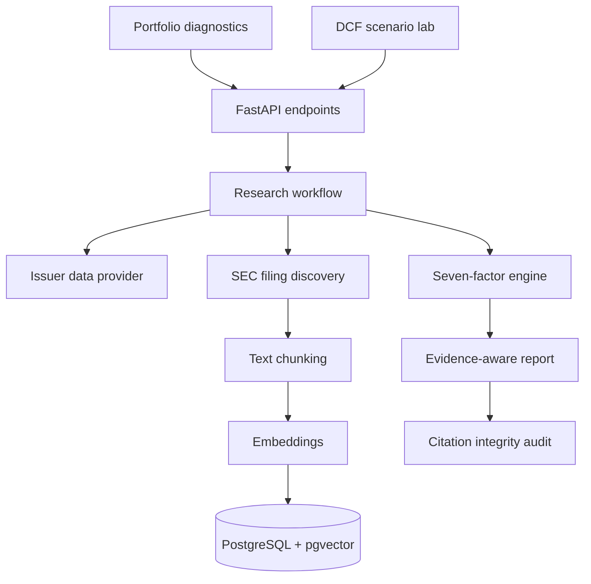

# EquityMind Research Studio

**An independently implemented equity-research workbench for factor screening, filing evidence, portfolio diagnostics and valuation scenarios.**

EquityMind Research Studio is a new implementation based on the high-level product brief for an agentic equity-research platform. It keeps research evidence and quantitative calculations separate, makes missing data visible, and adds portfolio-level tools that help turn single-stock research into a portfolio decision workflow.

> **Prototype status (v0.1.0):** the API, seven transparent factor calculations, DCF sensitivity engine, portfolio concentration/stress diagnostics, citation audit, SEC filing-discovery client and pgvector retrieval primitives are implemented. The bundled universe contains five **fictional demonstration fixtures**. It is not connected to live market-data providers by default and does not claim 250 live tickers or live filing coverage. Configure data providers and a database before using it for real research.

## What's different in this edition

| Capability | What it does |
| --- | --- |
| Seven-factor research screen | Separately reports valuation, momentum, risk, quality, analyst consensus, short interest and news sentiment. Missing signals remain unavailable rather than being scored as neutral. |
| Portfolio diagnostics | Calculates position weights, sector mix, Herfindahl concentration and configurable sector-shock contributions. |
| Bull / base / bear valuation lab | Runs a discounted cash-flow sensitivity grid with editable growth, margin, discount-rate and terminal-growth assumptions. |
| Citation integrity audit | Checks that evidence references used in a report resolve to supplied evidence IDs and identifies unused evidence. |
| SEC filing discovery | Uses SEC EDGAR submissions metadata to find recent 10-K and 10-Q filings with an explicit User-Agent. |
| pgvector retrieval primitives | Chunks filing text and retrieves ticker-scoped evidence by cosine similarity using parameterized SQL. |
| Research progress stream | Provides a server-sent-events endpoint for workflow progress and the final structured report. |
| Optional LangGraph orchestration | Uses a LangGraph state graph when the optional agent dependencies are installed, with a deterministic fallback otherwise. |
| Optional FinBERT inference | Loads ProsusAI/finbert lazily and converts positive/negative probabilities into a signed sentiment score. |

## Architecture



The core design separates four concerns:

- **Data ingestion:** provider adapters retrieve issuer facts and SEC filing metadata.
- **Evidence retrieval:** filings are chunked, embedded and retrieved with ticker-scoped vector similarity.
- **Quantitative analysis:** pure functions calculate factor signals and portfolio / valuation diagnostics.
- **Orchestration and API:** FastAPI exposes the workflow; LangGraph is optional and does not own the financial calculations.

## Technology

- Python 3.11+
- FastAPI and Pydantic v2
- LangGraph (optional workflow orchestration)
- PostgreSQL and pgvector (optional evidence storage)
- SEC EDGAR submissions API
- FinBERT via Transformers (optional local sentiment inference)
- pytest

## Quick start

### 1. Create an environment

**Windows PowerShell**

```powershell
py -3.12 -m venv .venv
.\.venv\Scripts\Activate.ps1
python -m pip install --upgrade pip
```

**macOS / Linux**

```bash
python3 -m venv .venv
source .venv/bin/activate
python -m pip install --upgrade pip
```

### 2. Install the application

Core API and demo mode:

```bash
python -m pip install -e ".[dev]"
```

Install optional capabilities as needed:

```bash
python -m pip install -e ".[agent,database]"  # LangGraph + PostgreSQL/pgvector adapters
python -m pip install -e ".[nlp]"              # FinBERT / Transformers / PyTorch
python -m pip install -e ".[sec]"              # SEC HTML parsing helpers
```

### 3. Configure environment

```bash
cp .env.example .env
```

On Windows PowerShell:

```powershell
Copy-Item .env.example .env
```

The local demo works without external API keys. Set `VECTOR_DIMENSIONS` to the same dimension used by the `embedding VECTOR(...)` column if you edit the schema. Keep `.env` out of version control. When securing a deployed API, set a strong `API_KEY` and send it in the `X-API-Key` header. The SEC client requires a descriptive `SEC_USER_AGENT` containing a contact email address.

### 4. Start PostgreSQL + pgvector + the API with Docker Compose

This is the recommended RAG setup. Compose starts PostgreSQL with pgvector, initializes `sql/schema.sql` on first database-volume creation, and starts FastAPI with the PostgreSQL driver installed.

**Windows PowerShell**

```powershell
Copy-Item .env.example .env
notepad .env
# Set OPENAI_API_KEY and replace SEC_USER_AGENT with your real contact email.
docker compose up --build -d
docker compose ps
```

**macOS / Linux**

```bash
cp .env.example .env
# Edit .env and set OPENAI_API_KEY plus a real SEC_USER_AGENT contact email.
docker compose up --build -d
docker compose ps
```

Check <http://127.0.0.1:8000/health> and open the interactive API docs at <http://127.0.0.1:8000/docs>.

Follow logs with `docker compose logs -f api` or `docker compose logs -f db`. The default database password is for local development only. Change `POSTGRES_PASSWORD` before exposing the database to any network. Keep `.env` private: it is ignored by Git and must never be committed. OpenAI API usage is billed separately; set a project budget before ingesting large filings.

### 5. Run the tests

```bash
pytest
```

## API reference

| Method | Endpoint | Purpose |
| --- | --- | --- |
| GET | `/health` | Service health and demo-mode status |
| GET | `/api/v1/universe` | List local demo tickers |
| GET | `/api/v1/filings/recent/{cik}` | Discover recent SEC 10-K and 10-Q filings |
| POST | `/api/v1/filings/ingest` | Download, chunk, embed and store a filing in pgvector (requires keys/database) |
| POST | `/api/v1/evidence/search` | Retrieve ticker-scoped filing passages by semantic similarity |
| POST | `/api/v1/research/rag` | Retrieve filing evidence and generate an auditable, cited OpenAI answer |
| POST | `/api/v1/research` | Run the seven-factor research workflow |
| POST | `/api/v1/research/stream` | Stream progress and final research result using SSE |
| POST | `/api/v1/portfolio/analyze` | Portfolio weights, concentration and sector stress |
| POST | `/api/v1/scenarios/dcf` | Bull / base / bear DCF scenario grid |
| POST | `/api/v1/citations/audit` | Validate report citation IDs against supplied evidence |

Example research request:

```bash
curl -X POST http://127.0.0.1:8000/api/v1/research \
  -H "Content-Type: application/json" \
  -d '{"ticker":"MSFT","question":"Assess business quality and key downside risks."}'
```

Example portfolio request:

```json
{
  "positions": [
    {"ticker": "MSFT", "market_value": 40000, "sector": "Technology"},
    {"ticker": "JPM", "market_value": 30000, "sector": "Financials"},
    {"ticker": "AMZN", "market_value": 30000, "sector": "Consumer Discretionary"}
  ]
}
```

Example DCF request:

```json
{
  "ticker": "MSFT",
  "current_price": 430,
  "revenue": 245000000000,
  "shares_outstanding": 7400000000,
  "free_cash_flow_margin": 0.28,
  "cash": 80000000000,
  "debt": 70000000000,
  "revenue_growth": 0.10,
  "discount_rate": 0.09,
  "terminal_growth": 0.025,
  "forecast_years": 5
}
```

### End-to-end filing RAG example

1. Find the issuer's CIK and recent filing metadata using `GET /api/v1/filings/recent/{cik}`. Microsoft's CIK is `789019`.
2. Select a recent 10-K or 10-Q result and copy its `filing_date`, `accession_number`, and `url`.
3. Submit those returned values to `POST /api/v1/filings/ingest`:

```json
{
  "ticker": "MSFT",
  "cik": "789019",
  "filing_type": "10-K",
  "filing_date": "YYYY-MM-DD",
  "accession_number": "SEC accession number from step 1",
  "filing_url": "SEC filing URL from step 1"
}
```

The endpoint downloads the SEC document, chunks its text, creates OpenAI embeddings, and stores vectors and source metadata in pgvector.

4. Ask a question grounded in stored passages by sending this JSON to `POST /api/v1/research/rag`:

```json
{
  "ticker": "MSFT",
  "question": "What principal risks does management describe for cloud services?",
  "top_k": 6
}
```

The response includes the generated answer, source passages, SEC URLs, similarity values, and a citation audit. Citation auditing checks whether citation IDs refer to retrieved passages; it does not independently validate the model's interpretation.

The Compose schema uses `VECTOR(1536)`, matching the default `text-embedding-3-small` output. If embedding dimensions are changed, update both `VECTOR_DIMENSIONS` and the SQL column definition. Changing an existing database requires a migration; the init script only runs when the database volume is first created.

## PostgreSQL / pgvector schema

The optional database schema is in `sql/schema.sql`. It enables pgvector and creates:

- `filing_chunks` for SEC filing passages, metadata and embeddings;
- `research_runs` for structured research outputs and run metadata;
- `investment_theses` for user-authored thesis statements and invalidation conditions.

The API now supports the complete filing-evidence path: SEC filing discovery, download and chunking, OpenAI embeddings, PostgreSQL/pgvector persistence, ticker-scoped semantic retrieval, and OpenAI answer generation with citation auditing. User accounts and persistent investment-thesis CRUD are not yet wired into the HTTP routes.

## Data quality and safeguards

- Demo fixtures are illustrative and must not be interpreted as current market prices or actual issuer facts.
- The included research endpoint returns `is_demo_data=true` for fixture-backed research.
- The seven-factor composite renormalizes only over available factors. Missing observations are not silently imputed as zero.
- Signal weights and score transforms are explicit in `equitymind/quant.py`; they are heuristics, not statistically calibrated alpha forecasts.
- Historical volatility, VaR and drawdown describe the supplied observation window and do not predict future risk.
- Analyst target prices can be biased; they are shown as a separate signal.
- The DCF lab is assumption-sensitive. It does not model dilution, changing capital structure, cyclicality or probability-weighted scenarios.
- Citation auditing verifies reference IDs, not the truth of a passage or the correctness of an LLM's interpretation.
- No endpoint places trades or provides personalized investment advice.

## Next engineering milestones

1. Connect a licensed market-data provider and build a timestamped issuer universe with 250+ symbols.
2. Complete SEC filing ingestion, embedding generation, pgvector persistence and source-citation linking.
3. Add PostgreSQL migrations, authentication, persistent thesis tracking and audit logs.
4. Add integration tests against a disposable pgvector database and provider contract tests.
5. Add a separate web client for saved research, portfolio views and scenario comparison.

## Project origin and attribution

This is a **fresh implementation** based on a high-level product brief for an EquityMind equity-research platform. It has its own code, project structure, test suite and Git history; it is not a copy of the original repository. The earlier collaborative prototype that informed the product brief is linked here for context: [BoFu001/equitymind-core](https://github.com/BoFu001/equitymind-core). The shared project's authorship and contributions remain with that original project and should be represented accurately in academic or professional descriptions.

## License

MIT. See [LICENSE](LICENSE).
